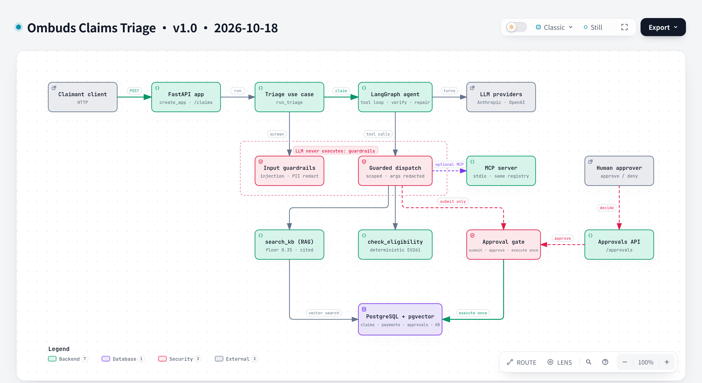
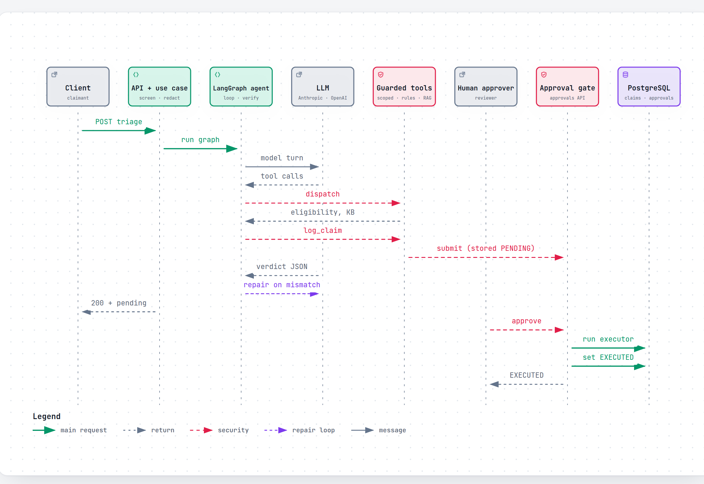

# Ombuds — agentic claims-triage system

**An agentic claims-triage system — built to demonstrate production-grade AI engineering, not just an LLM demo.**

Ombuds is a support/claims-triage capstone project built as a 4-week hands-on prep exercise for an AI & Agentic Engineer (Forward Deployed Engineer) role. Its purpose is to prove — with real, running, testable code — the full set of skills that role requires: LLM fundamentals, agentic orchestration, RAG, MCP-based tool exposure, human-in-the-loop governance, and production observability.

## The problem

A passenger's flight is cancelled and they file a claim. Someone has to read it, find the applicable policy, work out whether EU261 compensation is owed and how much, and record the outcome. Handing that whole job to an LLM is the obvious move and the wrong one:

- **The amount is a rule, not an opinion.** EU261 compensation depends on distance tiers, notice period and exemption reasons. A model that gets it plausibly right is still wrong some of the time, and the error is a real payout.
- **A confident model is not a permitted one.** An agent that can call a "pay this claim" tool can be talked into calling it. Claim text is untrusted input.
- **Someone has to be able to explain what happened.** Reviewers need to see what the rules engine said and which policy text backs it, not what the model felt.

Ombuds keeps the parts of the job an LLM is good at (reading messy claim text, deciding which facts to look up, explaining the result) and takes the parts it must not own (the eligibility decision, the permission to act) out of its hands.

## The core architectural claim

> **The LLM decides *how* to investigate a claim. It never becomes the source of truth for the claim's outcome.**

A tool being *callable* by the agent must never imply automatic *permission* to execute the underlying action. That boundary — enforced in code and policy, not just prompted for — is the single idea this whole project is built to demonstrate.

## Design

*Component view. Full table, deployment and layering notes in [`docs/architecture.md`](docs/architecture.md). Diagram sources are in [`docs/diagrams/`](docs/diagrams/README.md).*

A claim comes in — for example, a flight cancellation compensation claim. Ombuds:

1. **Guards its inputs.** Claim text is screened for prompt injection and redacted for PII before the model sees it. A suspected injection never reaches the model; it goes to a human.
2. **Reads and investigates.** An LLM either asks the passenger a clarifying question or works through a tool loop. Its final verdict is a schema-validated JSON object, never free-text parsing.
3. **Retrieves policy** via RAG (`search_kb`) — policy documents from pgvector, cited, not invented, and dropped below a relevance floor.
4. **Checks eligibility** against a deterministic rules engine (`check_eligibility`, EU261 tiers and exemptions) — the LLM can *ask* for this fact, it can never *decide* it.
5. **Verifies the verdict.** The model's decision is re-checked against the rules result. A mismatch triggers up to two repair turns, then escalates to a human.
6. **Gates risky actions behind a human.** A state-changing tool call (`log_claim` today; `issue_payment`, which the agent is never offered) only *submits* a payload-bound approval request, made of server-issued and rules-derived values, never model-authored ones. It does this whatever the model's confidence. The W4 OPA/Rego policy is meant to let low-risk logging auto-execute and always require a human for money.
7. **Executes only after approval.** Once a human approves, the action runs exactly once against Postgres, which the LLM never owns ([ADR-0009](docs/decisions/0009-approval-request-is-the-pending-action.md)): `log_claim` writes the `claims` row, and `issue_payment` writes a *simulated* payout record to `payments` (there is no real payment rail) and requires a logged claim with a matching amount.

*One triage, then the later human approval. Note that nothing changes state until the second half.*

More diagrams: [guardrails pipeline](docs/architecture.md#guardrails-and-tool-scoping), [RAG and evals](docs/architecture.md#rag-and-evals), [MCP process boundary](docs/architecture.md#mcp-process-boundary), [data model](docs/architecture.md#data-model), [layering](docs/architecture.md#layering), [approval lifecycle](docs/decisions/0009-approval-request-is-the-pending-action.md#lifecycle-of-an-approval-request) and [triage graph](docs/decisions/0005-prompted-json-with-repair-over-native-structured-output.md#the-triage-graph-end-to-end), [Compose startup](docs/architecture.md#deployment), [memory](docs/architecture.md#memory) and [prompt versioning](docs/architecture.md#prompt-versioning). The full index is in [`docs/diagrams/`](docs/diagrams/README.md), and each diagram is explained twice (simply, and for an interviewer) in [`docs/diagrams/explained.md`](docs/diagrams/explained.md).

### How it is built

- **Feature-sliced layout** ([ADR-0002](docs/decisions/0002-feature-sliced-over-clean-layers.md)). `features/claims_triage/` holds everything specific to claims; `platform/` is feature-agnostic (LLM providers, guardrails, MCP, persistence); `domain/` holds shared models. Imports run `features → platform → domain`, never back.
- **One agent, an explicit graph.** A LangGraph state graph with a bounded tool loop (at most 8 tool turns, 2 repairs); anything that doesn't converge becomes an escalation, not an exception.
- **Tools reach the agent two ways.** In-process by default, or over a real MCP session with the stdio server spawned as a subprocess. The graph cannot tell the difference.
- **Approvals live in Postgres,** so the API keeps no per-process approval state and a restart loses nothing.
- **Stack.** Python ≥3.11 · FastAPI · LangGraph · MCP · Anthropic/OpenAI APIs · PostgreSQL + pgvector · Docker Compose · pytest.

### Run it

| Command | Does |
|---|---|
| `make up` / `make down` | Full stack: db, migrations + KB ingest, API on `localhost:8000` (needs `OPENAI_API_KEY` and `ANTHROPIC_API_KEY` in `.env`) |
| `make test` | Lint (ruff, mypy strict), then unit tests |
| `make test-integration` | Real Postgres/pgvector and a real MCP round-trip, LLM mocked |
| `make eval` | Retrieval hit@k / MRR over `evals/datasets/` (needs `OPENAI_API_KEY`; prints a report, never fails) |

## Trade-offs

Each row is a real choice between alternatives, with what was given up. The full reasoning, including alternatives considered and when to revisit, is in the linked ADR.

| Decision | Chosen | Given up | ADR |
|---|---|---|---|
| Agent framework | LangGraph, one agent with an explicit state graph | CrewAI/AutoGen convenience for multi-agent demos; unneeded for one agent making tool calls | [0001](docs/decisions/0001-langgraph-over-crewai.md) |
| Code layout | Feature-sliced: `domain/`, `features/`, `platform/` | Crisp horizontal layers. Import direction is enforced by convention, not tooling | [0002](docs/decisions/0002-feature-sliced-over-clean-layers.md) |
| MCP | A subpackage of the same codebase, spawned over stdio | A real microservice boundary. Extractable later because feature tools never import it | [0003](docs/decisions/0003-mcp-as-subpackage-not-service.md) |
| Structured output | Prompted JSON plus a client-side verify/repair loop | Server-side guaranteed schema. The repair loop can also carry semantic checks against the rules result | [0005](docs/decisions/0005-prompted-json-with-repair-over-native-structured-output.md) |
| Provider resilience | SDK retries plus a hand-rolled fallback provider | A single retry library. Mid-stream failures must not replay output, which a decorator can't express | [0006](docs/decisions/0006-two-layer-resilience-over-a-retry-library.md) |
| Streaming | Server-Sent Events | A bidirectional channel. Nothing can be sent back mid-stream | [0007](docs/decisions/0007-sse-over-websockets-for-triage-streaming.md) |
| Human approval | The approval request *is* the pending action: submit, human approves, execute exactly once, state in Postgres | The agent can't report the final outcome in the same run. An in-memory retry model ([0008](docs/decisions/0008-in-memory-poll-based-human-approval.md)) was superseded | [0009](docs/decisions/0009-approval-request-is-the-pending-action.md) |
| Vector store | pgvector inside the one Postgres, plain SQL and numbered migrations | A dedicated vector DB and an ORM. Fine for hundreds to thousands of chunks, not tuned beyond that | [0010](docs/decisions/0010-pgvector-in-postgres-over-chroma.md) |
| PII | Regex plus checksum redaction at every trust boundary | Recall: names and postal addresses are not detected. Redaction is irreversible | [0013](docs/decisions/0013-regex-pii-redaction-at-the-trust-boundaries.md) |
| Prompt injection | Heuristic detection that escalates to a human | Recall on paraphrase and unusual languages. Real protection is structural (scoped tools, server-issued `claim_id`, the approval gate) | [0014](docs/decisions/0014-heuristic-injection-detection-escalates.md) |

### Known limitations

- **Observability, governance policy and audit are not built.** OpenTelemetry tracing, the OPA/Rego payout policy and the audit trail are Week 4 work. Their files exist as stubs, and until the policy engine exists `log_claim` also requires a human.
- **Payments are simulated.** `issue_payment` writes a record to a local table; there is no payment rail and no real airline or claims vendor behind the tools.
- **One vertical.** Only airline EU261 exists. The seam for a second vertical is structural, not yet exercised by a second implementation.
- **No authentication on `/approvals`.** The approver name is a caller-supplied string.
- **PII and injection defences are heuristics.** See the trade-off rows above for what they miss.
- **Retrieval is measured, not tuned.** `make eval` reports retrieval quality; there is no end-to-end answer-quality eval yet.

## Why airline claims (EU261)

Flight cancellation/delay compensation was chosen as the first concrete vertical because it needs no contrived complexity to justify every piece of the architecture:

- Compensation eligibility is a real, checkable, deterministic rule set (distance tiers, notice period, exemption reasons) — a natural fit for a tool the LLM calls but doesn't compute itself.
- A payout is real money — nobody needs convincing that it should require human approval.
- Past claims and policy documents give RAG genuine work to do, not decorative retrieval.

The architecture is deliberately domain-agnostic underneath: `features/claims_triage/` doesn't know it's handling flights. A second vertical (e.g. bus or rail delay claims) would mean adding one rules module and one evidence schema — zero changes to the agent, the guardrails, or the approval flow. Only one vertical (airline) is built in this 4-week scope.

## What this project is not

- Not autonomous — no state-changing action fires without a human or a hard policy check approving it.
- Not a UI product — API + agent + demo script only.
- Not integrated with a real airline/claims vendor — tools are mocked against a local Postgres, proving the *pattern* (agent → MCP → deterministic backend), not a vendor integration.
- Not multi-agent — one LangGraph agent, one tool set.

## Status: Weeks 1–3 built, pre-W4 refactor done

The agent, RAG, Postgres-backed approvals and execution, MCP server, Docker Compose stack and PII/injection guardrails work. This README and the diagrams are the first Week 4 deliverable; observability, the OPA policy and the audit trail are not built yet.

| Week | Focus |
|---|---|
| 1 | Raw LLM API calls, tool-calling loop, structured output, `/triage` endpoint, tests |
| 2 | LangGraph agent, MCP server, agent memory, human-approval gate |
| 3 | RAG pipeline, Postgres + vector store, Docker Compose, PII/injection guardrails |
| 4 | Observability (OpenTelemetry), OPA/Rego policy, audit trail, architecture docs |

Design decisions: [`docs/decisions/`](docs/decisions/). Architecture detail: [`docs/architecture.md`](docs/architecture.md).
