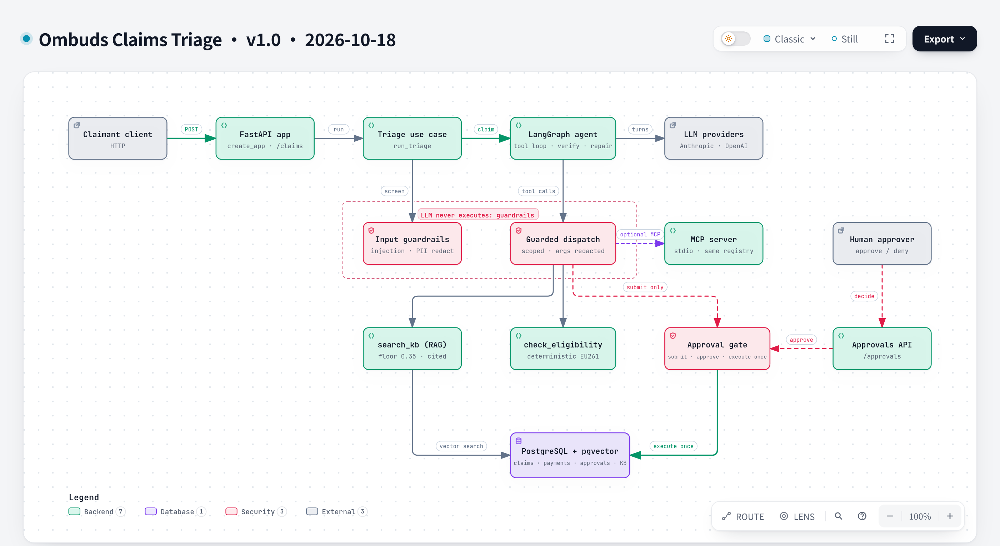
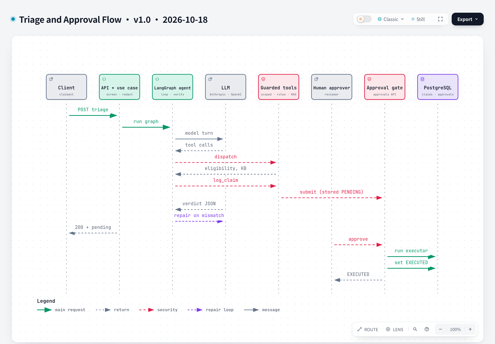
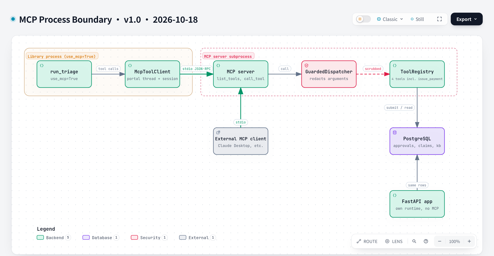

# Architecture

Ombuds triages airline EU261 claims with an LLM agent, but the LLM never owns the outcome: eligibility comes from a deterministic rules engine, and every state change waits for a human approval and then runs exactly once. This page shows how the pieces fit. Design decisions and what was given up are in [`decisions/`](decisions/).

## Component view

Diagram: [Ombuds Claims Triage v1.0](diagrams/architecture.md) (interactive HTML, source and regeneration steps are on that page). Each component's source lines are cited in its JSON.

| Component | What it does | Code |
|---|---|---|
| FastAPI app | Composition root: opens the Postgres pool, builds the approval store and tool registry, mounts the routes | `api_app.py`, `features/claims_triage/api/routes.py` |
| Triage use case | Issues a server-side `claim_id`, screens and redacts the claim, then runs the graph | `features/claims_triage/application/triage_use_case.py` |
| Input guardrails | Injection heuristics escalate to a human with no model call (ADR-0014); PII is redacted before the model sees it (ADR-0013) | `platform/guardrails/injection_detection.py`, `pii_filter.py` |
| LangGraph agent | Tool-calling loop, then checks the final verdict against the latest `check_eligibility` result; repairs or escalates | `features/claims_triage/agent/graph.py`, `application/decision.py` |
| LLM providers | Anthropic and OpenAI behind one protocol, with fallback (ADR-0006) | `platform/ai/providers/` |
| Guarded dispatch | Overwrites any model-supplied `claim_id`, redacts tool arguments, never offers `issue_payment` to the agent | `platform/guardrails/guarded_dispatcher.py`, `features/claims_triage/tools/__init__.py` |
| MCP server | Exposes the same tool registry over stdio; spawned as a subprocess of the API (ADR-0003) | `platform/mcp/` |
| `search_kb` | RAG over policy docs in pgvector, relevance floor 0.35, cited results | `features/claims_triage/tools/search_kb.py`, `rag/` |
| `check_eligibility` | Deterministic EU261 rules: distance tiers, notice, exemptions | `features/claims_triage/verticals/airline/rules.py` |
| Approval gate | State-changing tools only submit a payload-bound request; a human approves it and the executor then runs once (ADR-0009) | `platform/guardrails/approval_gate.py`, `executing_store.py`, `application/executors.py` |
| Approvals API | Lists, approves and denies pending requests | `platform/guardrails/api.py` |
| PostgreSQL + pgvector | One database for claims, payments, approvals and KB embeddings (ADR-0010) | `platform/infrastructure/` |

## Triage and approval flow

One triage and the later human approval are two separate moments: the agent only submits `log_claim`, and only after a human approves does the executor write to Postgres.

Diagram: [Triage and Approval Flow v1.0](diagrams/triage-approval-flow.md)

## MCP process boundary

With `use_mcp=True` the library path spawns the MCP server as a subprocess; the HTTP API does not use MCP. Decision: [ADR-0003](decisions/0003-mcp-as-subpackage-not-service.md).

Diagram: [MCP Process Boundary v1.0](diagrams/mcp-boundary.md)

## Guardrails and tool scoping

Where untrusted text is screened and redacted, and where the model's authority ends. Decisions: [ADR-0013](decisions/0013-regex-pii-redaction-at-the-trust-boundaries.md), [ADR-0014](decisions/0014-heuristic-injection-detection-escalates.md).

Diagram: [Guardrails and Tool Scoping Pipeline v1.0](diagrams/guardrails-pipeline.md)

## RAG and evals

Offline ingest and online retrieval meet at the `kb_chunks` table, and the eval harness sweeps the relevance floor over saved scores. Decisions: [ADR-0010](decisions/0010-pgvector-in-postgres-over-chroma.md), [ADR-0011](decisions/0011-heading-aware-chunking-and-openai-embeddings.md), [ADR-0012](decisions/0012-retrieval-relevance-floor.md).

Diagram: [RAG Ingest, Retrieval and Evals v1.0](diagrams/rag-evals-pipeline.md)

## Data model

Five tables in one Postgres database: approvals, claims, payments, long-term memory and the knowledge base.

Diagram: [Postgres Data Model v1.0](diagrams/data-model.md)

## Layering

Imports run `features → platform → domain`, never the reverse. `platform/` has no airline or triage knowledge. Only the composition roots (`api_app.py`, the MCP server entrypoint) wire a feature into the platform (ADR-0002).

Diagram: [Layering and Composition Roots v1.0](diagrams/layering.md)

## Deployment

`docker compose up` (via `make up`) runs three services: `db`, a one-shot `migrate-ingest`, and `api` on port 8000. The API keeps no approval state in process, because approvals live in Postgres.

Diagram: [Docker Compose Startup v1.0](diagrams/compose-startup.md)

## Memory

Short-term memory lives in the graph state for one run; long-term memory is loaded and saved per claimant. Both hold only rules-derived facts.

Diagram: [Memory Flow v1.0](diagrams/memory-flow.md)

## Prompt versioning

Prompts are versioned files; the live version is chosen by `CLAIMS_TRIAGE_PROMPT_VERSION` (v4 today) and old versions stay as history.

Diagram: [Prompt Versioning v1.0](diagrams/prompt-versioning.md)

## Development history

Two boards show how the project was built, week by week: [Ombuds Development Board, v1.0](diagrams/development-overview.md) (steps and key decisions) and [Ombuds Development Board v2, v1.0](diagrams/development-overview-v2.md) (steps only, each linked to its code at a fixed commit).

## Not built yet

OpenTelemetry tracing, the OPA/Rego payout policy and the audit trail are Week 4 work. The files exist as stubs and the diagram does not draw them.
