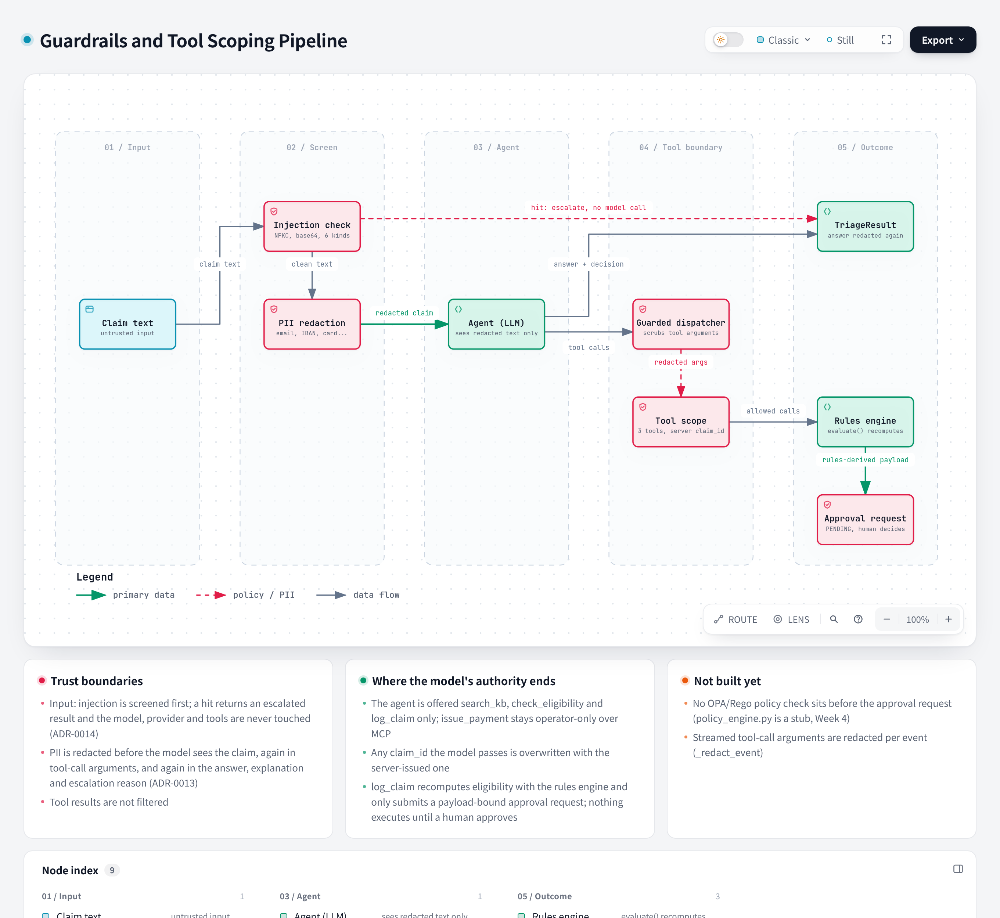

# Architecture

Ombuds triages airline EU261 claims with an LLM agent, but the LLM never owns the outcome: eligibility comes from a deterministic rules engine, and every state change waits for a human approval and then runs exactly once. This page shows how the pieces fit. Design decisions and what was given up are in [`decisions/`](decisions/).

## Component view


The diagram is generated with archify from [`diagrams/archify/architecture.json`](diagrams/archify/architecture.json), which pins the commit it was traced from and cites source lines per component. The interactive HTML is committed next to it as `diagrams/archify/architecture.html` (about 820 KB, so the repo's `check-added-large-files` limit is 1000 KB). To regenerate it, run from the repo root:

```bash
node ~/.claude/skills/archify/bin/archify.mjs finalize architecture docs/diagrams/archify/architecture.json /tmp/ombuds-architecture.html --repo-root . --quality showcase
```

| Component | What it does | Code |
|---|---|---|
| FastAPI app | Composition root: opens the Postgres pool, builds the approval store and tool registry, mounts the routes | `api_app.py`, `features/claims_triage/api/routes.py` |
| Triage use case | Issues a server-side `claim_id`, screens and redacts the claim, then runs the graph | `features/claims_triage/application/triage_use_case.py` |
| Input guardrails | Injection heuristics escalate to a human with no model call (ADR-0014); PII is redacted before the model sees it (ADR-0013) | `platform/guardrails/injection_detection.py`, `pii_filter.py` |
| LangGraph agent | Tool-calling loop, then checks the final verdict against the latest `check_eligibility` result; repairs or escalates | `features/claims_triage/agent/graph.py`, `application/decision.py` |
| LLM providers | Anthropic and OpenAI behind one protocol, with fallback (ADR-0006) | `platform/ai/providers/` |
| Guarded dispatch | Overwrites any model-supplied `claim_id`, redacts tool arguments, never offers `issue_payment` to the agent | `platform/guardrails/guarded_dispatcher.py`, `features/claims_triage/tools/__init__.py` |
| MCP server | Exposes the same tool registry over stdio; spawned as a subprocess of the API (ADR-0003) | `platform/mcp/` |
| `search_kb` | RAG over policy docs in pgvector, relevance floor 0.35, cited results | `features/claims_triage/tools/search_kb.py`, `rag/` |
| `check_eligibility` | Deterministic EU261 rules: distance tiers, notice, exemptions | `features/claims_triage/verticals/airline/rules.py` |
| Approval gate | State-changing tools only submit a payload-bound request; a human approves it and the executor then runs once (ADR-0009) | `platform/guardrails/approval_gate.py`, `executing_store.py`, `application/executors.py` |
| Approvals API | Lists, approves and denies pending requests | `platform/guardrails/api.py` |
| PostgreSQL + pgvector | One database for claims, payments, approvals and KB embeddings (ADR-0010) | `platform/infrastructure/` |

## Triage and approval flow


Source: [`diagrams/archify/triage-approval-flow.json`](diagrams/archify/triage-approval-flow.json) (interactive page: `diagrams/archify/triage-approval-flow.html`), regenerated the same way with `sequence` in place of `architecture`. The agent only ever *submits* `log_claim`; the human approval later is a separate request, and only then does the executor write to Postgres. A suspected injection, a verdict that still disagrees with the rules engine after two repairs, or more than eight tool turns all end in an escalation to a human instead of a verdict.

## Guardrails and tool scoping



Where untrusted text is screened and redacted, and where the model's authority ends: it never chooses the `claim_id`, is never offered `issue_payment`, and `log_claim` only submits a rules-derived approval request. Source: [`diagrams/archify/guardrails-pipeline.json`](diagrams/archify/guardrails-pipeline.json) (interactive page: `diagrams/archify/guardrails-pipeline.html`), regenerated the same way with `dataflow` in place of `architecture`. Decisions: [ADR-0013](decisions/0013-regex-pii-redaction-at-the-trust-boundaries.md), [ADR-0014](decisions/0014-heuristic-injection-detection-escalates.md).

## Layering

Imports run `features → platform → domain`, never the reverse. `platform/` has no airline or triage knowledge. Only the composition roots (`api_app.py`, the MCP server entrypoint) wire a feature into the platform (ADR-0002).

## Deployment

`docker compose up` (via `make up`) runs three services: `db` (pgvector/pgvector:pg16), a one-shot `migrate-ingest` (migrations plus KB ingest), and `api` on port 8000. The API keeps no approval state in process, because approvals live in Postgres.

## Development history

Two diagrams show how the project was built, week by week: [`diagrams/archify/development-overview.html`](diagrams/archify/development-overview.html) (v1: steps and key decisions) and [`diagrams/archify/development-overview-v2.html`](diagrams/archify/development-overview-v2.html) (v2: steps only, each linked to its code at a fixed commit). Each has a `.json` source and a `.png` next to it.

## Not built yet

OpenTelemetry tracing, the OPA/Rego payout policy and the audit trail are Week 4 work. The files exist as stubs and the diagram does not draw them.
