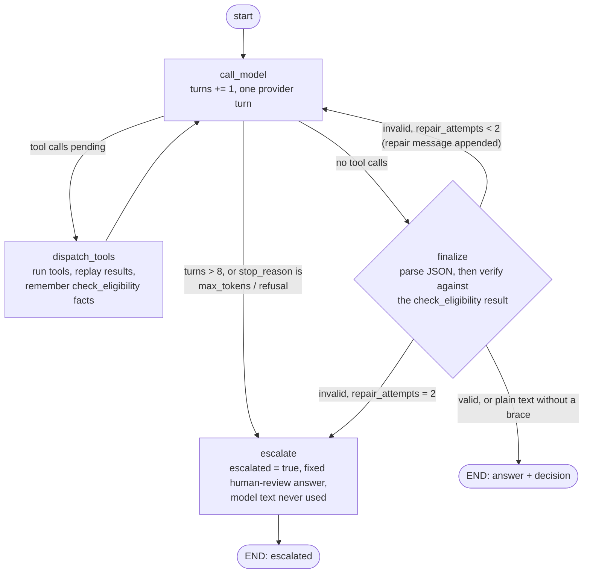

# ADR-0005: Prompted JSON with a repair loop over native structured-output enforcement

**Status:** accepted
**Date:** 2026-09-26

## Context
Once `check_eligibility` has answered, the agent needs to hand back one machine-checkable verdict (`TriageDecision`: eligible, amount, reason codes, explanation) — not free text a caller would have to re-parse. Anthropic's Messages API offers two ways to get schema-shaped output: constrain generation directly (`output_config.format`, or a forced tool call whose input schema *is* the answer), or prompt for JSON and validate/repair on the client side. The loop already has two response modes — plain text (a clarifying question) or a tool call — and a third, structurally different mode needed to slot in without the model having to be taught a new decision point about *which* mode to use.

## Decision
Prompt the model (`platform/prompts/claims_triage/v3.txt`) to reply with a single JSON object once it has a verdict, and validate/repair that reply client-side (`platform/ai/schemas/structured_output.py`, `application/triage_use_case.py`) rather than constraining generation through `output_config.format` or a forced tool call.

## Consequences
- The final turn stays a normal assistant reply. Distinguishing "plain-text answer" from "a JSON verdict" is a bare `"{" in text` check on that one reply, not a new field or a third response type the rest of the loop has to branch on.
- A reply that looks like a JSON attempt but fails to parse or validate becomes a repair turn: the validation error is appended as the next user message, and the model gets `MAX_REPAIR_ATTEMPTS` (2) tries before the error propagates. That repair path is now the natural place to enforce more than shape — see the note below.
- Enforcement was originally shape-only: a reply that validated against `TriageDecision` was accepted even if it disagreed with `check_eligibility`'s actual result, or if `check_eligibility` was never called (W1 review, finding F-01). Fixed in the pre-W2 hardening pass by `application/decision.py`'s `verify_decision()`, which checks a parsed decision's `eligible`/`compensation_amount_eur`/`reason_codes` against the latest successful `check_eligibility` result and raises the same `StructuredOutputError` a shape failure would — so a content mismatch is repaired through the same loop, with the same `MAX_REPAIR_ATTEMPTS` budget, rather than needing a second mechanism. Not a reason to swap the enforcement mechanism, since the fix slots into the repair path this ADR already chose.
- `stream_triage()`'s SSE path does not run this validation at all (a deliberate, separately-tracked gap — see the "Add structured output validation" task summary and the W1 review's F-07). Native structured-output enforcement wouldn't have avoided this: the gap is that streaming never reaches the final-turn check, not a shape-validation problem.
- Revisit if a future decision needs enforcement stronger than "valid shape can still be substantively wrong" — that already needs a semantic check independent of which mechanism produces the shape, at which point the repair loop's flexibility (it can carry any validation error, not just a schema one) matters more than the mechanism used to get JSON in the first place.

## The triage graph, end to end

Three counters bound the loop: `turns` (cap `MAX_TOOL_TURNS = 8`), `repair_attempts` (cap `MAX_REPAIR_ATTEMPTS = 2`) and the unrecoverable stop reasons. Every path ends at `END`; running out of budget is a business outcome (`escalated`), never an exception. The routing mirrors `build_triage_graph().get_graph().draw_mermaid()` node for node. Sources: `features/claims_triage/agent/graph.py`, `agent/nodes/escalate_retry.py`, `application/decision.py` (`verify_decision`).

Memory beside the loop: `dispatch_tools` writes rules-derived facts into short-term memory (never into a prompt). `run_triage` loads long-term memory by `claimant_id` into the first user message and writes `last_*` facts back after a verified run. The HTTP routes do not pass `claimant_id` yet, so cross-run memory is only used by the library path.

## Alternatives considered
- **`output_config.format` (constrained decoding on the final turn).** Guarantees schema-valid JSON server-side, but the model still needs a plain-text mode for clarifying questions, so the loop would need to know in advance which turn is "the decision turn" before asking — the same problem this design avoids by treating it as a bare `"{" in text` check on a reply the model produced without that instruction baked into the API call. It also still says nothing about whether the *content* is right (see the F-01 gap above), so it would not have avoided that defect either.
- **A forced tool call for the final verdict** (e.g. a `submit_decision` tool). Turns the verdict into a third tool alongside `check_eligibility`/`log_claim`, which reads oddly next to "tools are things you *do*, not how you *answer*" — and still needs the same content check against `check_eligibility`'s result once forced, so it wins nothing on the F-01 gap either. Worth reconsidering only if the free-text/JSON prose split itself turns out to be unreliable in practice, which the current unit tests and eval gap (F-11) haven't yet given a reason to believe.
