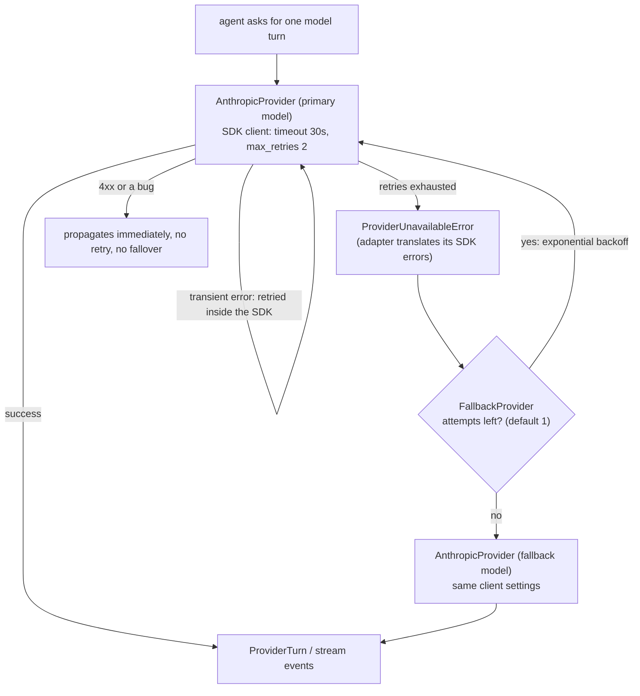

# ADR-0006: Two-layer resilience (SDK retries + hand-rolled model fallover) over a single retry library

**Status:** accepted
**Date:** 2026-09-26

## Context
A live Anthropic call can fail in two structurally different ways: a transient blip (a dropped connection, a 429, a 5xx) that the *same* model would likely succeed at on a second try, and the primary model being unavailable altogether (rate-limited into the ground, a regional outage, a deprecated model) where retrying that model is pointless and a *different* model should answer instead. A generic retry/backoff library (e.g. `tenacity`) can express the first case as a decorator, but the second case — falling over to a distinct `LLMProvider` instance, and doing so differently for a buffered call versus a stream that may have already emitted output to the caller — isn't a decorator's shape.

## Decision
Split resilience into two layers: `AnthropicProvider` builds its `anthropic.Anthropic` client with `timeout`/`max_retries`, delegating transient connection/429/5xx handling to the SDK's own exponential backoff; `FallbackProvider` (`platform/ai/providers/fallback.py`) wraps a `primary` and `fallback` `LLMProvider` and retries the primary with its own backoff before failing over to the fallback entirely. No general-purpose retry library was added.

## Consequences
- The two layers have distinct jobs and don't have to agree on what "retryable" means at the same granularity — the SDK's own client already knows which of *its* exceptions are transient network/HTTP conditions; `FallbackProvider` only needs to know "the primary is not answering, try the other model."
- `FallbackProvider.stream_turn()` only fails over before any event has reached the caller. Once a partial stream has been yielded, retrying or switching models would replay or duplicate output the caller already saw, so a mid-stream failure is raised as-is instead — a distinction a generic retry decorator wrapping the whole call wouldn't express, since it operates on the call as one unit, not on "has output already left this generator."
- `FallbackProvider.run_turn()`/`stream_turn()` originally caught bare `Exception`, on the grounds that this layer is provider-agnostic (Anthropic today, OpenAI/others later per ADR-0001) and can't enumerate every wrapped provider's own exception hierarchy — that was `docs/code-style.md`'s one stated exception to "no bare `except Exception`". The W1 review (finding F-03) flagged that this retried *everything*, including non-retryable errors (4xx, our own bugs) and stacked with the SDK's own retries. That's fixed (see the pre-W2 hardening pass): each provider adapter now translates its own SDK exceptions into one shared `ProviderUnavailableError` at the adapter boundary (`platform/ai/providers/base.py`), and `FallbackProvider` catches only that type — a narrowing within this same two-layer design, not a reason to replace it with a library. `docs/code-style.md`'s carve-out line was updated accordingly; there is no longer a bare `except Exception` in `src/`.
- Revisit if a second, genuinely different SDK is wired in as a real fallback (not another Anthropic model) and its retryable-error set turns out not to fit the same `ProviderUnavailableError` translation cleanly — that's the point where a shared retry library's pluggable retry-predicate might earn its place over two hand-rolled loops.

## How a failure travels

For `stream_turn` there is one extra rule: fallover is allowed only while nothing has been yielded to the caller. Once the first event is out, a `ProviderUnavailableError` is re-raised as-is and the SSE route turns it into an `error` frame (see [ADR-0007](0007-sse-over-websockets-for-triage-streaming.md)). Sources: `platform/ai/providers/fallback.py`, `platform/ai/providers/base.py`.

## Alternatives considered
- **One retry library across both layers** (e.g. `tenacity` wrapping the whole `primary` call, with a second decorated call to `fallback` on exhaustion). Handles the "retry the same model" case fine, but the mid-stream "don't replay output already sent to the caller" rule and the "switch to a structurally different `LLMProvider`, not just retry the same callable" step don't fit a retry decorator's model of one call, one predicate, one backoff — they need the fallover logic that lives in `FallbackProvider` regardless of what handles the innermost retries.
- **No client-level SDK retries, only `FallbackProvider`.** Would mean every transient blip immediately escalates to a full model fallover instead of a same-model retry, wasting the fallback model's availability on failures the primary would have recovered from on its own within a second retry.
