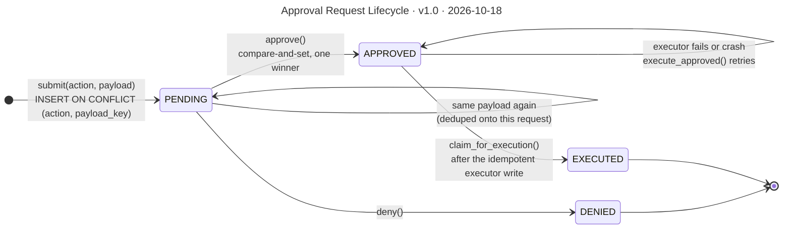

# Approval Request Lifecycle

**Version** 1.0 · **Date** 2026-10-18 · **Tool** Mermaid · **Type** state · **Pinned commit** `364363b`
**Decisions** [ADR-0009](../decisions/0009-approval-request-is-the-pending-action.md), [ADR-0008](../decisions/0008-in-memory-poll-based-human-approval.md) (superseded)
**Source** see the sources listed under "What it shows"

## What it shows

Every arrow other than the dedupe and retry loops is a compare-and-set `UPDATE ... WHERE status = <expected>`. A second `approve`, a `deny` after approval, or a second claim finds the status already moved and raises `ApprovalStateError` (HTTP 409), writing nothing. Sources: `platform/guardrails/approval_gate.py` (`ApprovalStatus`), `executing_store.py` (`approve`, `execute_approved`), `platform/infrastructure/repositories.py` (`PostgresApprovalStore._transition`).

## Like I'm 5

Think of a permission slip for a school trip. It starts as "waiting". A teacher can say yes, then the slip is "approved", or no, then it is "denied" and the story ends. After a yes, the trip happens and the slip is stamped "used". A used slip cannot be used again, and a denied slip cannot be turned into a yes. If the bus breaks down before the stamp, the slip stays "approved" and the trip can be tried again, but it still only happens once.

## For an interviewer

An approval request has four states: pending, approved, denied and executed. Submitting dedupes on action plus payload, so the same payload returns the existing request and changed facts create a new one. Every transition is a compare-and-set update that only succeeds if the row is still in the expected status, so two concurrent approvals cannot both win, and a second approve, or a deny after approval, raises a state error that the API returns as 409. Approving wins pending to approved, runs the executor registered for the action, then wins approved to executed. The executor write is idempotent, using insert on conflict do nothing, and runs before the final transition. The transaction model is idempotent write, then claim, instead of one database transaction, which keeps the store protocol free of connection handling and works for effects outside Postgres. Trade-off: a crash in between leaves the request approved, and execute_approved is the recovery path. Honest gap: nothing calls that recovery automatically yet, so a failed execution surfaces as an error from approve.

## Likely follow-up

Why not one transaction for the write and the status change? It would couple the store to the executor and break for non-Postgres effects.

## Regenerate

Mermaid: edit the diagram in this file, bump the version and date in its front-matter `title:` and in the header, and add a change-log line.

## Change log

- 1.0 (2026-10-18): moved here from `decisions/0009-approval-request-is-the-pending-action.md` (section "Lifecycle of an approval request"); title, version and date added to the diagram.
