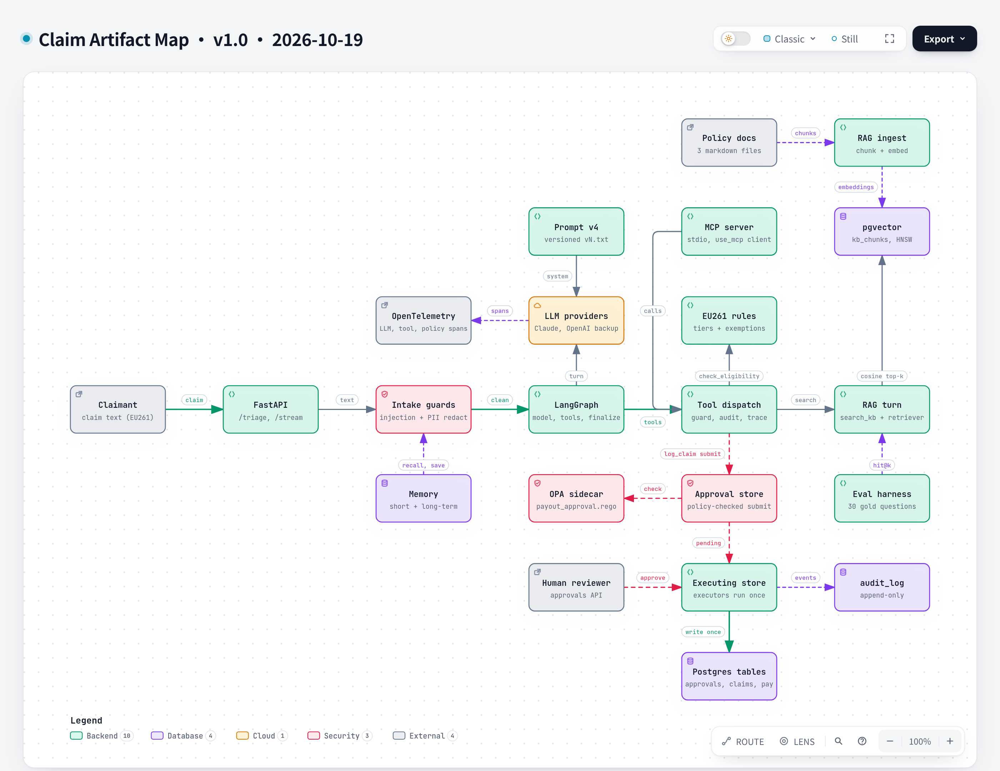

# Claim Artifact Map

**Version** 1.1 · **Date** 2026-10-23 · **Tool** archify · **Type** component · **Pinned commit** `6a738dc`
**Decisions** [ADR-0003](../../decisions/0003-mcp-as-subpackage-not-service.md), [ADR-0009](../../decisions/0009-approval-request-is-the-pending-action.md), [ADR-0010](../../decisions/0010-pgvector-in-postgres-over-chroma.md), [ADR-0015](../../decisions/0015-opa-sidecar-over-embedded-evaluation.md), [ADR-0016](../../decisions/0016-append-only-postgres-audit-log-at-the-governance-seams.md), [ADR-0017](../../decisions/0017-opentelemetry-spans-at-the-existing-seams.md)
**Source** `api_app.py`, `application/runtime.py`, `agent/graph.py`, `agent/memory/`, `rag/`, `platform/guardrails/`, `platform/mcp/`, `platform/observability/`, `evals/run_evals.py`

Source: [`artifact-map.json`](artifact-map.json)

## What it shows

Every artifact one claim touches: the API and intake guards, the LangGraph loop and its LLM, the tool dispatch with the EU261 rules, the RAG turn into pgvector, memory, MCP and OpenTelemetry, then the policy check, approval store, human reviewer and executors that write to Postgres. Each node is tagged with the stage it plays in the claims-assessment brief (intake gate, line mapper, coverage engine, risk router, human gate, rules store). The cards list what the brief asks for and the code does not have yet.

## Like I'm 5

Think of a post office. A letter comes in and a clerk checks it is safe. A helper reads it and looks things up in a rule book. Another helper does the sums with a calculator, never by guessing. If money has to move, a form goes in a tray and a boss must sign it before anyone pays. Every step is written in a notebook that nobody can erase.

## For an interviewer

The brief's split is "the LLM reads, code decides, humans gate, everything is audited". This map shows where each part lives. The LLM only plans tool calls and drafts a verdict. The EU261 rules code computes the amount, and the verdict is verified against it. State-changing tools only submit a payload-bound approval request, OPA can deny at submit, and execution happens once after a human approves. Knowledge comes through a RAG turn over pgvector with a relevance floor, measured by a retrieval eval and an agent eval. Spans and an append-only audit log cover the governance seams. Honest gaps: there is no OCR or vision intake (the input is claim text), no member accumulators or policy versions, and the agent eval (`make eval-agent`) is manual and never gates CI. MCP and OpenTelemetry edges are summarised, since spans also cover tool dispatch and policy checks.

## Likely follow-up

Why is the rules code not in the LLM? Money must be exact and repeatable, so the model never calculates or approves.

## Regenerate

`python docs/diagrams/render_archify.py artifact-map` after editing the JSON (bump the version and date in `meta.title`).

## Change log

- 1.1 (2026-10-23): the empty-agent-eval gap becomes a manual agent eval.
- 1.0 (2026-10-19): first versioned release.
