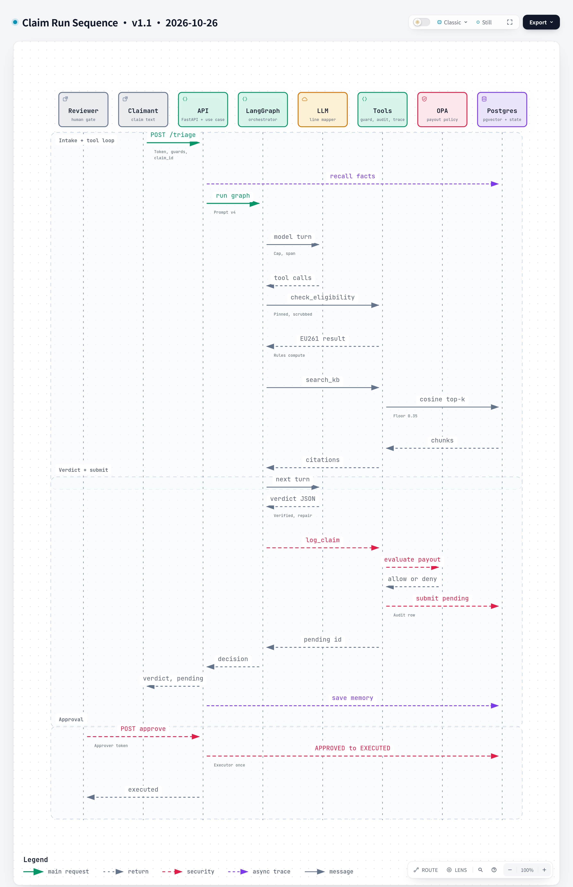

# Claim Run Sequence

**Version** 1.1 · **Date** 2026-10-26 · **Tool** archify · **Type** sequence · **Pinned commit** `314d9a1`
**Decisions** [ADR-0009](../../decisions/0009-approval-request-is-the-pending-action.md), [ADR-0012](../../decisions/0012-retrieval-relevance-floor.md), [ADR-0014](../../decisions/0014-heuristic-injection-detection-escalates.md), [ADR-0015](../../decisions/0015-opa-sidecar-over-embedded-evaluation.md), [ADR-0019](../../decisions/0019-static-bearer-tokens-per-router.md)
**Source** `triage_use_case.py`, `agent/graph.py`, `tools/`, `rag/retriever.py`, `platform/guardrails/policy_checked_store.py`, `executing_store.py`, `api.py`

Source: [`claim-sequence.json`](claim-sequence.json)

## What it shows

One airline claim from the POST to the executed payment, in three groups: intake and the tool loop, the verified verdict and the pending approval, and the later human approval. It is the whole run in order: triage and approval are two separate moments, and only the second changes state. A suspected injection, a verdict that still disagrees with the rules engine after two repairs, or more than eight tool turns all end in an escalation to a human instead of a verdict (not drawn as a branch). Both callers need a bearer token, one for triage and a different one for approving (ADR-0019).

## Like I'm 5

You hand a form to a clerk. The clerk checks it for tricks and hides your private details, then asks a helper. The helper looks in the rule book, asks a calculator for the sum and writes an answer. A checker makes sure the answer matches the calculator. The answer only becomes a request in a tray. Later a boss signs it, and only then does anything change, exactly once.

## For an interviewer

The order is the point. Guards run before any model call. The model plans tool calls, the rules code returns the amount and the retriever returns cited chunks above a 0.35 floor. The model's verdict is verified against the rules, with two repairs before an escalation. `log_claim` goes to OPA and, if allowed, submits a pending request with a server-issued claim id, so the model never chooses it. Approval is a separate request: the approvals API approves, the executor writes the claim once, and every step writes an audit row and a span. Trade-off: the agent cannot tell the claimant the final outcome in the same run. Gaps: memory needs a claimant id, MCP and the escalation branches are not drawn, and some notes are shortened to fit.

## Likely follow-up

What if OPA denies? No approval request is created, so a human cannot approve it from the queue. What if the executor fails after approval? The request stays approved, the write is idempotent, and `POST /approvals/{id}/execute` re-runs it safely, although nothing retries automatically.

## Regenerate

`python docs/diagrams/render_archify.py claim-sequence` after editing the JSON (bump the version and date in `meta.title`).

## Change log

- 1.0 (2026-10-19): first versioned release.
- 1.1 (2026-10-26): absorbed the former Triage and Approval Flow diagram, which was removed as a subset of this one: token notes on the POST and the approval, the escalation paths in the text, and the failed-executor retry.
