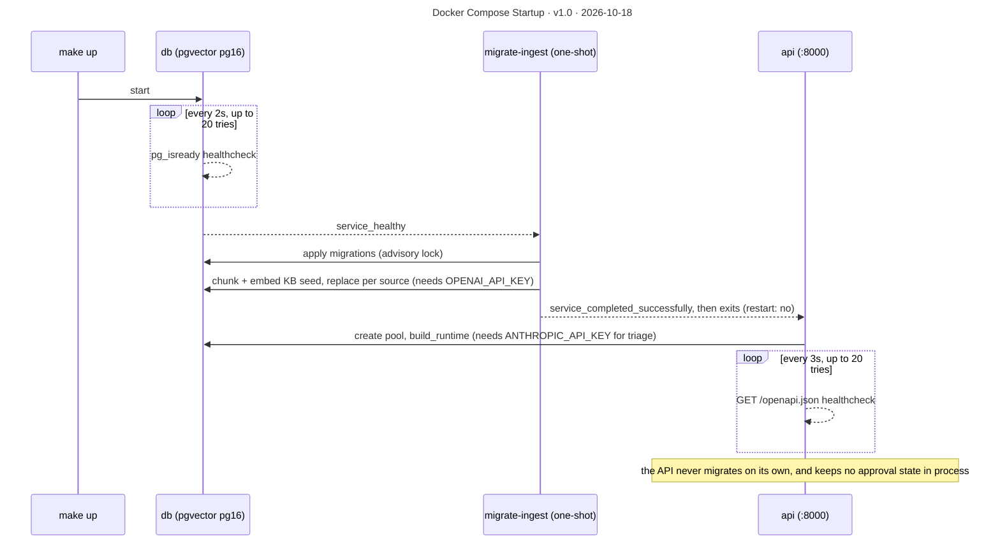

# Docker Compose Startup

**Version** 1.0 · **Date** 2026-10-18 · **Tool** Mermaid · **Type** sequence · **Pinned commit** `241f2ae`
**Decisions** none (see [architecture.md](../../architecture.md#deployment))
**Source** see the sources listed under "What it shows"

## What it shows

`docker compose up` (via `make up`) runs three services: `db` (pgvector/pgvector:pg16), a one-shot `migrate-ingest` (migrations plus KB ingest), and `api` on port 8000. The API keeps no approval state in process, because approvals live in Postgres.

`api` waits on both `db` (healthy) and `migrate-ingest` (completed successfully), so a failed migration or ingest keeps the API from starting. Both steps are idempotent, so running `make up` again is safe. Source: `docker-compose.yml`.

## Like I'm 5

Think of building a house. First the builders lay the foundation, and we wait until it is really solid. Then a helper puts in the pipes and the furniture, does the job once, and goes home. Only when both are finished do we open the front door and let visitors in. If the pipes fail, the door stays shut, so nobody walks into a broken house. And if we do it all again tomorrow, nothing is spoiled, because every step checks what is already there.

## For an interviewer

make up runs docker compose with three services. The db service is pgvector on Postgres 16 with a pg_isready healthcheck every two seconds. migrate-ingest is a one-shot job with restart set to no. It waits for the database to be healthy, applies the SQL migrations under an advisory lock, then chunks and embeds the knowledge base seed documents, which needs an OpenAI key. The api service depends on both the database being healthy and migrate-ingest completing successfully, so a failed migration or ingest keeps the API from starting. The API never migrates on its own. It has its own healthcheck on the OpenAPI document. Every step is idempotent, because migrations are recorded and ingest replaces each source's rows, so running make up again is safe. Approvals live in Postgres, so the API holds no approval state in process and is not tied to a single replica. The MCP server runs as a subprocess of the API container when used. Trade-off: ingest runs on every start, which costs embedding calls. Honest gap: this is a local and demo deployment, with no tracing, metrics or secrets management.

## Likely follow-up

How would you do migrations in production? Run the same one-shot job as a release step before rolling out the API.

## Regenerate

Mermaid: edit the diagram in this file, bump the version and date in its front-matter `title:` and in the header, and add a change-log line.

## Change log

- 1.0 (2026-10-18): moved here from `architecture.md` (section "Deployment"); title, version and date added to the diagram.
