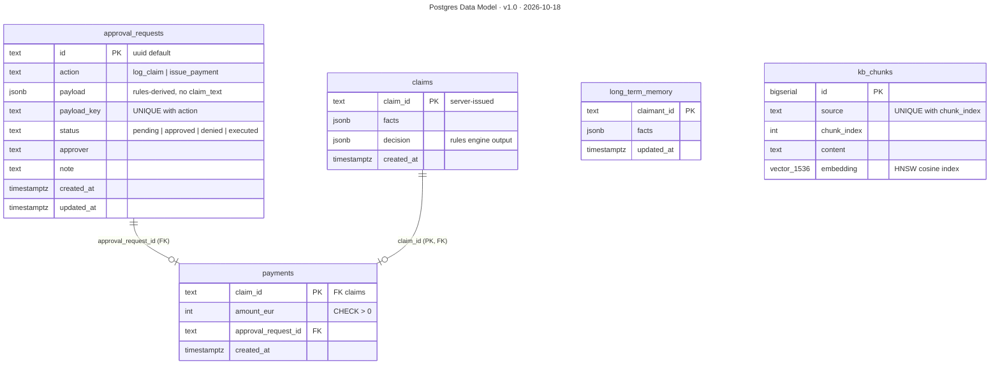

# Postgres Data Model

**Version** 1.0 · **Date** 2026-10-18 · **Tool** Mermaid · **Type** ER · **Pinned commit** `241f2ae`
**Decisions** [ADR-0009](../decisions/0009-approval-request-is-the-pending-action.md), [ADR-0010](../decisions/0010-pgvector-in-postgres-over-chroma.md)
**Source** see the sources listed under "What it shows"

## What it shows

Only `payments` has foreign keys: one payment per claim, and only for a logged claim. The `claim_id` inside an `approval_requests.payload` is a logical link, not a foreign key. `long_term_memory` and `kb_chunks` stand alone, and `schema_migrations` (applied versions, under an advisory lock) is omitted. Sources: `platform/infrastructure/migrations/0001_init.sql`, `0002_payments.sql`; decisions [ADR-0009](../decisions/0009-approval-request-is-the-pending-action.md) and [ADR-0010](../decisions/0010-pgvector-in-postgres-over-chroma.md). `long_term_memory` has no caller in the HTTP API yet.

## Like I'm 5

Think of a filing cabinet with five drawers. One drawer holds requests waiting for a grown-up to say yes. One holds claims that were written down. One holds payments, and each payment must be stuck to a claim, so you can never have a payment for a claim nobody wrote down. One holds little notes about each person, and one holds the pieces of the rule book with their number codes. Each drawer has a clear label, and some drawers have a rule like "no two folders may be the same".

## For an interviewer

Everything lives in one Postgres database with pgvector. approval_requests holds the action, a JSON payload, a payload key and a status constrained to pending, approved, denied or executed. Uniqueness on action plus payload key is the dedupe: a retried submit is an insert that does nothing on conflict, not a read-then-write race. claims stores the facts and the rules-engine decision, with a server-issued identifier. payments has the only foreign keys: one payment per claim, only for a logged claim, linked to the approval that authorised it, with an amount above zero. long_term_memory and kb_chunks stand alone, and kb_chunks has a 1536-dimension vector with an HNSW cosine index. The claim identifier inside an approval payload is a logical link, not a foreign key. Migrations are numbered SQL files applied under an advisory lock, so the API and the MCP server can start together. Trade-off: one store is simpler, but vector search scale is limited. Honest gap: there is no audit table yet, because the audit repository is a stub.

## Likely follow-up

How do you stop a double payment? The primary key on claim id in payments, plus an insert that ignores conflicts, makes retries a no-op.

## Regenerate

Mermaid: edit the diagram in this file, bump the version and date in its front-matter `title:` and in the header, and add a change-log line.

## Change log

- 1.0 (2026-10-18): moved here from `architecture.md` (section "Data model"); title, version and date added to the diagram.
