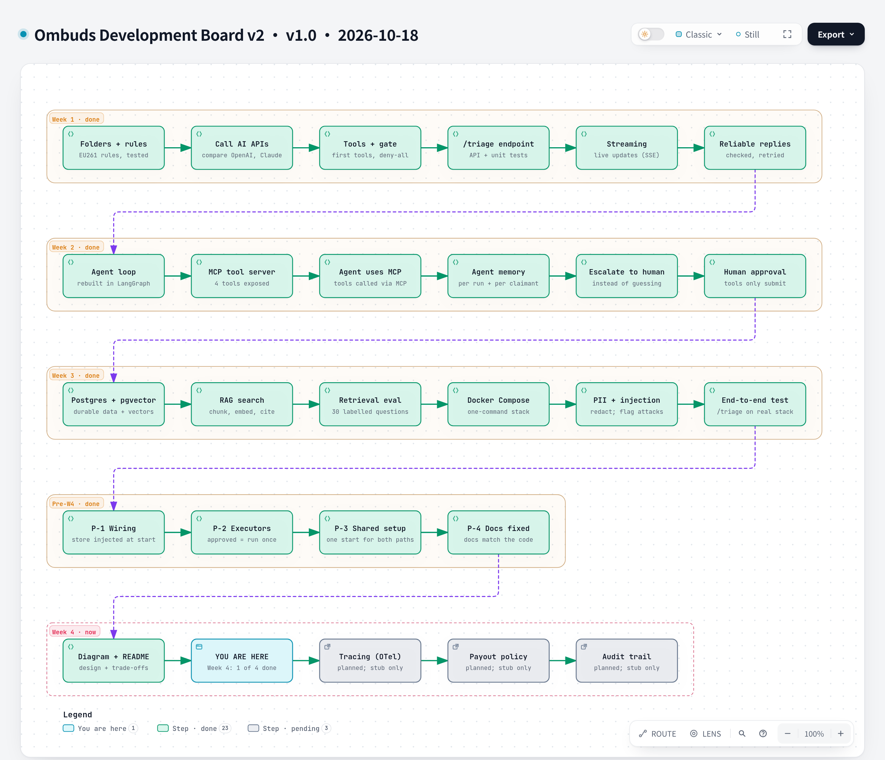

# Ombuds Development Board v2

**Version** 1.0 · **Date** 2026-10-18 · **Tool** archify · **Type** timeline board · **Pinned commit** `4eaf960`
**Decisions** ADR-0001 to ADR-0014 (see v1 for the decision view)
**Source** `docs/progress/tasks.md`; generated from `development-overview-v2.json`



Interactive version: [`archify/development-overview-v2.html`](archify/development-overview-v2.html) · Source: [`archify/development-overview-v2.json`](archify/development-overview-v2.json)

## What it shows

The same build history as version 1 of the board, reduced to steps only, with each step linked to its code at a fixed commit.

## Like I'm 5

It is the same map as the first board, but every step has a link, so you can click from a step such as 'Human approval' straight to the code that does it.

## For an interviewer

Where v1 explains the decisions, v2 is the evidence: each step points at the code at a pinned commit, so a claim like 'approvals are exactly-once' can be checked in the source rather than taken on trust.

## Likely follow-up

Why two boards? One is for narrating decisions, the other for proving the steps exist in code.

## Regenerate

Edit [`archify/development-overview-v2.json`](archify/development-overview-v2.json) (bump the version and date in `meta.title`), then from the repo root:

```bash
python docs/diagrams/src/render_archify.py development-overview-v2
```

This runs `archify finalize architecture` and rewrites the `.html` and `.png` next to the JSON. The HTML stays under the repo's 1000 KB `check-added-large-files` limit.

## Change log

- 1.0 (2026-10-18): first versioned release; title, version and date added to the diagram itself.
