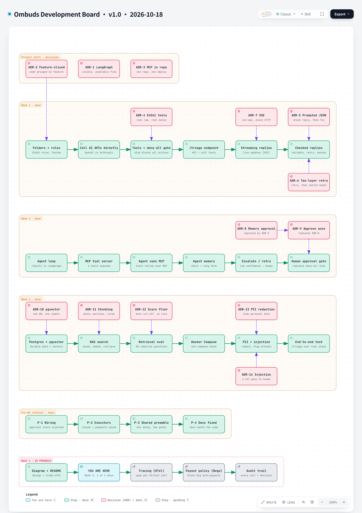

# Ombuds Development Board

**Version** 1.0 · **Date** 2026-10-18 · **Tool** archify · **Type** timeline board · **Pinned commit** `4e65657`
**Decisions** ADR-0001 to ADR-0014 (summarised on the board)
**Source** `docs/progress/tasks.md`, `docs/decisions/`; generated by [`development_board_gen.py`](../development_board_gen.py)



Interactive version: [`development-overview.html`](development-overview.html) · Source: [`development-overview.json`](development-overview.json)

## What it shows

The four-week build as a board: each step (done or pending), the ADR decisions with their dates, a marker for where the project is now, flagged gaps and a glossary of key terms. Version 1 includes the key decisions.

## Like I'm 5

This board is the project's to-do list drawn as a map. Week 1 is the basics (rules, calling the AI, tools). Week 2 is the agent loop and the tool server. Week 3 is the rule book search, the database, Docker and the safety checks. Week 4 is watching, policy and polish. The board marks what is done, what is still to do, and where we are now.

## For an interviewer

The build ran in four weekly slices: API fundamentals, the agent loop and MCP, RAG with the data layer, Docker and guardrails, then observability and governance, with a refactor between weeks 3 and 4 after review. Every real alternative is recorded as an ADR and dated on the board. The board lists the gaps on purpose: tracing, the Rego payout policy and the audit trail are still stubs, and the end-to-end eval dataset is empty.

## Likely follow-up

Which decision would you revisit first? ADR-0008 (in-memory, poll-based approval) was superseded by ADR-0009 (the approval request is the pending action, stored in Postgres).

## Regenerate

Edit [`development-overview.json`](development-overview.json) (bump the version and date in `meta.title`), then from the repo root:

```bash
python docs/diagrams/render_archify.py development-overview
```

This runs `archify finalize architecture` and rewrites the `.html` and `.png` next to the JSON. The HTML stays under the repo's 1000 KB `check-added-large-files` limit.

Board v1 is generated: edit [`development_board_gen.py`](../development_board_gen.py), run it to rewrite the JSON, then the command above.

## Change log

- 1.0 (2026-10-18): first versioned release; title, version and date added to the diagram itself.
