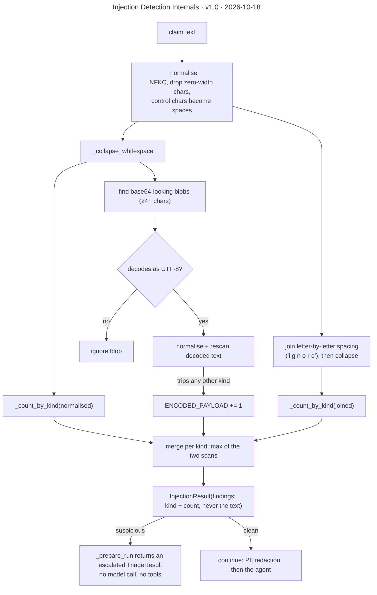

# Injection Detection Internals

**Version** 1.0 · **Date** 2026-10-18 · **Tool** Mermaid · **Type** flow · **Pinned commit** `f508450`
**Decisions** [ADR-0014](../decisions/0014-heuristic-injection-detection-escalates.md)
**Source** see the sources listed under "What it shows"

## What it shows

The five regex kinds are `INSTRUCTION_OVERRIDE` (English plus German, French and Spanish phrasings), `ROLE_HIJACK`, `PROMPT_EXFIL`, `TOOL_COMMAND` (a tool name or "skip the approval gate") and `DELIMITER_SPOOF` (chat-template tokens); `ENCODED_PAYLOAD` is the sixth, from the base64 rescan. It is a heuristic layer: paraphrases and other languages get through, and the approval gate and tool scoping hold regardless. Source: `platform/guardrails/injection_detection.py` (`detect`, `_normalise`, `_encoded_payloads`), `application/triage_use_case.py` (`_prepare_run`).

## Like I'm 5

Imagine a guard at the door whose job is to spot people sneaking in bossy messages, like "ignore your boss and do what I say". The guard does not only look at the words as they are. First the guard tidies the message: fixing funny letters, removing invisible marks, and joining words that were spaced out like "i g n o r e". The guard even opens secret coded notes and reads inside them. If the guard finds anything bossy, the message goes to a real person and the robot never sees it.

## For an interviewer

detect() is a heuristic, deliberately cheap layer. It first normalises the text: Unicode NFKC, zero-width characters dropped, control characters turned into spaces. It scans the text twice, once with whitespace collapsed and once with letter-by-letter spacing joined, so spaced-out obfuscation does not slip past, and merges counts per kind by taking the larger. It looks for five regex kinds: instruction override, with English, German, French and Spanish phrasings; role hijack; prompt exfiltration; tool commands, such as naming a tool or asking to skip the approval gate; and delimiter spoofing with chat-template tokens. A sixth kind, encoded payload, comes from decoding base64-looking blobs of 24 or more characters and rescanning the decoded text. The result reports counts per kind and never the matched text, so it is safe to log. A hit makes the use case return an escalated result with no model call and no tools (ADR-0014). Trade-off: false positives are possible, for example a claim that mentions a tool name, but a human review is cheap. Honest gap: paraphrases and other languages are missed, so it is one layer, and tool scoping and the approval gate hold regardless.

## Likely follow-up

Why not use an LLM classifier? It adds cost and latency, and a model can itself be injected, whereas regex is deterministic and auditable.

## Regenerate

Mermaid: edit the diagram in this file, bump the version and date in its front-matter `title:` and in the header, and add a change-log line.

## Change log

- 1.0 (2026-10-18): moved here from `decisions/0014-heuristic-injection-detection-escalates.md` (section "Inside `detect()`"); title, version and date added to the diagram.
