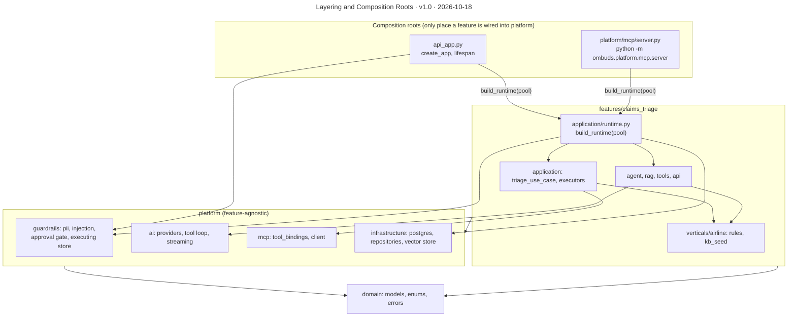

# Layering and Composition Roots

**Version** 1.0 · **Date** 2026-10-18 · **Tool** Mermaid · **Type** flow · **Pinned commit** `241f2ae`
**Decisions** [ADR-0002](../decisions/0002-feature-sliced-over-clean-layers.md), [ADR-0003](../decisions/0003-mcp-as-subpackage-not-service.md)
**Source** see the sources listed under "What it shows"

## What it shows

Imports run `features → platform → domain`, never the reverse. `platform/` has no airline or triage knowledge. Only the composition roots (`api_app.py`, the MCP server entrypoint) wire a feature into the platform (ADR-0002).

`build_runtime` assembles the Postgres-backed approval store, the executors and the tool registry once, and both roots call it, so the API and the MCP subprocess share one wiring and the same Postgres rows. `create_app` also accepts an injected store and registry so tests can pass in-memory fakes. The rule is convention only: nothing in `make lint` or the tests checks import direction. At this commit the only `platform` file that imports from `features` is `platform/mcp/server.py`, which is a composition root by design. Sources: `api_app.py` (35-65), `features/claims_triage/application/runtime.py` (25-32), `platform/mcp/server.py` (13).

## Like I'm 5

Imagine building with LEGO and one rule: bricks on top can lean on bricks below, but the bricks below must never need the ones on top. The bottom layer holds the simple facts about the world. The middle layer holds the general tools anyone could use, like a locksmith kit. The top layer holds the special things for this one job, like handling flight claims. Two special spots, the front door and the side door, are allowed to connect the top and the middle, and that is the only place where they are glued together.

## For an interviewer

The code is feature-sliced (ADR-0002). Imports run features to platform to domain, never the reverse. The platform has no airline or triage knowledge, so a second vertical would add a folder next to claims_triage rather than touch the platform. Only the composition roots wire a feature into the platform: the FastAPI app and the MCP server entrypoint. Both call build_runtime with a Postgres pool, which assembles the approval store, the executors and the tool registry, so the API and the MCP subprocess share one wiring. create_app also accepts an injected store and registry, so tests can pass in-memory fakes. The alternative was classic clean layers, which scatter one feature across many folders. Trade-off: more folders for a small codebase today. Honest gap: the rule is only a convention. Nothing in lint or tests checks import direction, and the one platform file that imports from features is the MCP server, a root by design. An import-linter check would enforce it.

## Likely follow-up

How would you enforce the rule automatically? Add import-linter contracts to CI and fail on a reverse import.

## Regenerate

Mermaid: edit the diagram in this file, bump the version and date in its front-matter `title:` and in the header, and add a change-log line.

## Change log

- 1.0 (2026-10-18): moved here from `architecture.md` (section "Layering"); title, version and date added to the diagram.
