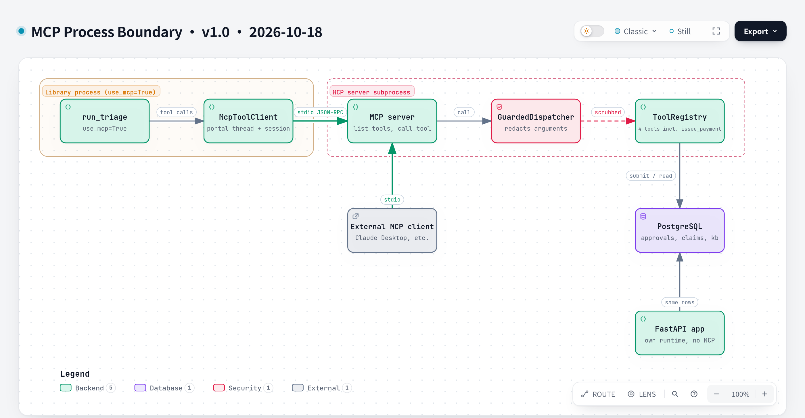

# MCP Process Boundary

**Version** 1.0 · **Date** 2026-10-18 · **Tool** archify · **Type** component · **Pinned commit** `a2cbe51`
**Decisions** [ADR-0003](../decisions/0003-mcp-as-subpackage-not-service.md)
**Source** `platform/mcp/server.py`, `platform/mcp/tool_bindings.py`, the MCP client in `platform/ai/`



Interactive version: [`archify/mcp-boundary.html`](archify/mcp-boundary.html) · Source: [`archify/mcp-boundary.json`](archify/mcp-boundary.json)

## What it shows

With `use_mcp=True` the library path spawns the MCP server as a subprocess and bridges its synchronous graph to an async MCP session; the HTTP API does not use MCP. The server builds the same Postgres-backed runtime as the API, so approvals are shared.

## Like I'm 5

Imagine the helper robot lives in one room and the toolbox lives in another room. They cannot walk to each other, so they pass notes through a small slot in the wall. The robot writes what it wants on a note, the toolbox reads it, does the job, and passes the answer back through the slot. The nice part is that other robots, from other companies, can also use the same slot and the same toolbox. And a guard at the slot covers up private things on every note.

## For an interviewer

MCP, the Model Context Protocol, lets the same tools be used by our agent and by external clients such as Claude Desktop. The server lives inside the platform package, a subpackage and not a separate service (ADR-0003). It is started with python -m ombuds.platform.mcp.server and talks over stdio. When run_triage is called with use_mcp set, it spawns that server as a subprocess. Because graph nodes are synchronous and the MCP session is async, the client runs the session on a background thread through an anyio blocking portal. The graph does not care which dispatcher it has, because both satisfy the same protocol. The server builds the same Postgres-backed runtime as the API, so an approval submitted over MCP appears in the approvals API, and arguments are redacted at the boundary. Trade-off: a subprocess adds startup cost and a failure mode, but keeps one codebase and one deploy. Honest gap: the HTTP routes do not use MCP, and external clients can reach issue_payment, still behind a human approval.

## Likely follow-up

Why not run MCP as its own microservice? It would add a deployment and network hop with no benefit for a single repository.

## Regenerate

Edit [`archify/mcp-boundary.json`](archify/mcp-boundary.json) (bump the version and date in `meta.title`), then from the repo root:

```bash
python docs/diagrams/src/render_archify.py mcp-boundary
```

This runs `archify finalize architecture` and rewrites the `.html` and `.png` next to the JSON. The HTML stays under the repo's 1000 KB `check-added-large-files` limit.

## Change log

- 1.0 (2026-10-18): first versioned release; title, version and date added to the diagram itself.
