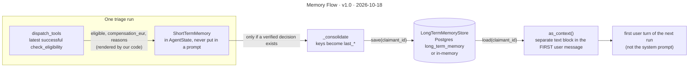

# Memory Flow

**Version** 1.0 · **Date** 2026-10-18 · **Tool** Mermaid · **Type** flow · **Pinned commit** `241f2ae`
**Decisions** [ADR-0009](../../decisions/0009-approval-request-is-the-pending-action.md) (rules-derived facts only); W2 review F-06
**Source** see the sources listed under "What it shows"

## What it shows

Both kinds hold only rules-derived facts, never model-written text, and memory is never promoted to system-prompt trust (W2 review F-06). Cross-run memory is opt-in: `run_triage` needs both a `claimant_id` and a `long_term_store`. The HTTP routes pass neither, so today only the library path uses it, and `PostgresLongTermMemoryStore` has no production caller. Sources: `agent/graph.py` (`_remember_eligibility`), `agent/memory/*`, `application/triage_use_case.py` (`run_triage`, `_consolidate`, `_first_user_message`).

## Like I'm 5

Imagine the helper has two notebooks. The first is a scratch pad for today. It holds the facts the calculator just told us, like "yes, this person gets a refund". When today is over, the scratch pad is thrown away. The second is a real notebook about each visitor, so the next time they come the helper can say "last time we decided this". Only facts from the calculator go into the notebooks, never things the helper only guessed. And the visitor notebook is shown as a note at the start, not mixed in with the helper's rules.

## For an interviewer

There are two kinds of memory and both hold only rules-derived facts, never model-written text. Short-term memory lives in the graph state for one run. After each successful check_eligibility, our code records eligible, the compensation amount and the reason codes, and it is never put in a prompt. Long-term memory persists across runs for a claimant. If a run reaches a verified decision, the short-term facts are consolidated into keys prefixed with last, and saved through a LongTermMemoryStore protocol, with an in-memory and a Postgres implementation. On the next run the facts are loaded and rendered as a separate text block in the first user message, not the system prompt, so nothing a past run stored is promoted to system-level trust. This came out of the W2 review. Trade-off: it only remembers what the rules engine produced, so it cannot recall nuance. Honest gap: cross-run memory is opt-in and needs both a claimant id and a store. The HTTP routes pass neither, and the Postgres store has no production caller, so today only the library path uses it.

## Likely follow-up

Why not let the model summarise past claims? Model-written memory can carry an injected instruction into every later run.

## Regenerate

Mermaid: edit the diagram in this file, bump the version and date in its front-matter `title:` and in the header, and add a change-log line.

## Change log

- 1.0 (2026-10-18): moved here from `architecture.md` (section "Memory"); title, version and date added to the diagram.
