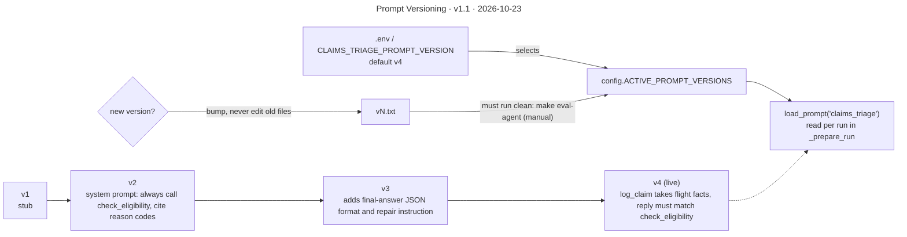

# Prompt Versioning

**Version** 1.1 · **Date** 2026-10-23 · **Tool** Mermaid · **Type** flow · **Pinned commit** `6a738dc`
**Decisions** none (see [architecture.md](../../architecture.md#prompt-versioning))
**Source** see the sources listed under "What it shows"

## What it shows

Old versions stay as history. The gate is a policy, not code: the end-to-end eval (`make eval-agent`, dataset `evals/datasets/airline_claims.jsonl`) exists but is run by hand and never fails CI. Sources: `src/ombuds/config.py` (`ACTIVE_PROMPT_VERSIONS`, `load_prompt`), `platform/prompts/claims_triage/v1.txt` to `v4.txt`, `evals/run_agent_evals.py`, `.env.example`.

## Like I'm 5

Imagine a cookbook where every recipe card has a number. When we want to change a recipe, we do not scribble on the old card. We write a brand new card, number two, and keep the old one in the box. Before the new card becomes the one we cook from, we have to taste the food and check it is not worse. A little note on the kitchen wall says which card number we are using today. If the new card is bad, we just point the note back to the old card.

## For an interviewer

Prompts are versioned files under platform prompts, one folder per feature, and never inline strings. The live version is chosen by an environment variable, CLAIMS_TRIAGE_PROMPT_VERSION, which config.py reads into the active-versions map. load_prompt reads the file once per run. Version four is live. Version one was a stub, version two introduced the system prompt that always calls check_eligibility and cites reason codes, version three added the final JSON answer format and repair instruction, and version four changed log_claim to take flight facts and required the reply to match the eligibility result. Old files are never edited, so rollback is a config change and history is preserved. The policy is that a new version must run clean against the eval datasets before becoming active, and a score regression should block a prompt or model change from merging. Trade-off: a file per version adds clutter in exchange for reproducibility. Honest gap: the gate is policy, not code. The agent eval (19 labelled claims, `make eval-agent`) is run by hand and never fails CI, so nothing blocks a prompt change that scores worse.

## Likely follow-up

How would you test a new prompt before releasing it? Run it against a labelled claims dataset and compare against the live version, which is `make eval-agent`, though comparing two versions is manual.

## Regenerate

Mermaid: edit the diagram in this file, bump the version and date in its front-matter `title:` and in the header, and add a change-log line.

## Change log

- 1.1 (2026-10-23): the agent eval now exists (`make eval-agent`); the gate is still manual.
- 1.0 (2026-10-18): moved here from `architecture.md` (section "Prompt versioning"); title, version and date added to the diagram.
