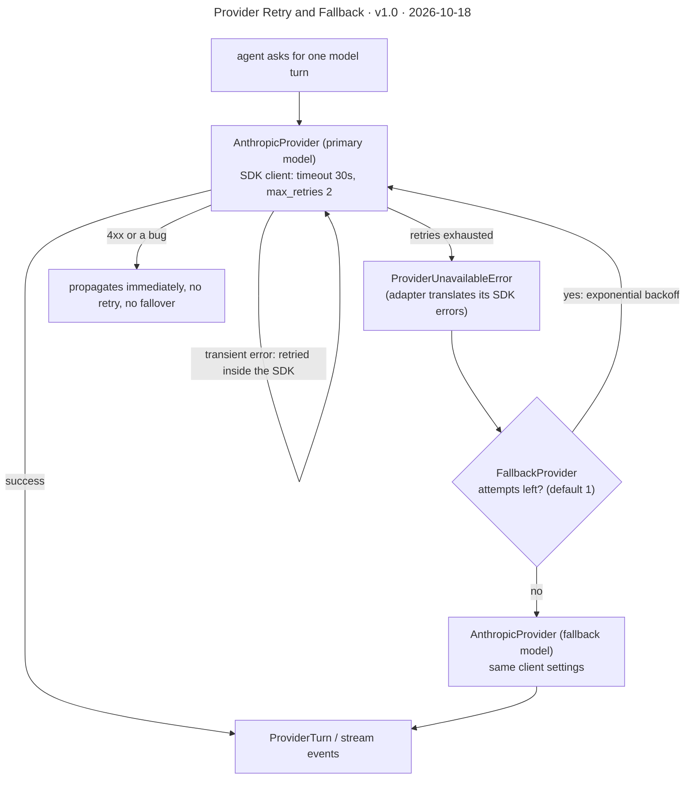

# Provider Retry and Fallback

**Version** 1.0 · **Date** 2026-10-18 · **Tool** Mermaid · **Type** flow · **Pinned commit** `a2cbe51`
**Decisions** [ADR-0006](../../decisions/0006-two-layer-resilience-over-a-retry-library.md), [ADR-0007](../../decisions/0007-sse-over-websockets-for-triage-streaming.md)
**Source** see the sources listed under "What it shows"

## What it shows

For `stream_turn` there is one extra rule: fallover is allowed only while nothing has been yielded to the caller. Once the first event is out, a `ProviderUnavailableError` is re-raised as-is and the SSE route turns it into an `error` frame (see [ADR-0007](../../decisions/0007-sse-over-websockets-for-triage-streaming.md)). Sources: `platform/ai/providers/fallback.py`, `platform/ai/providers/base.py`.

## Like I'm 5

Imagine you ride a bike to school and the tyre goes flat. First you try pumping it up again once or twice, because that usually works. If it still will not work, you do not give up and stay home. You grab your spare bike and ride that instead. There is one small rule: if you are already halfway through telling a story and the bike breaks, you cannot start the story over with a new bike, because the people listening already heard the first part.

## For an interviewer

Resilience has two layers because the failures are different. The Anthropic client handles transient blips, such as dropped connections, rate limits and server errors, with its own timeout of 30 seconds and two retries on the same model. When those run out, the adapter raises one shared ProviderUnavailableError. A FallbackProvider catches only that type, retries the primary with backoff if configured, and then falls over to a second model. Anything else, like a client error or a bug, propagates immediately so we never retry something that cannot succeed. For streaming there is an extra rule: failover is allowed only before the first event reaches the caller, because switching models mid-stream would replay or duplicate output. A mid-stream failure is raised, and the SSE route turns it into an error frame (ADR-0007). We did not use a generic retry library such as tenacity, because failing over to a different provider instance is not a decorator's shape (ADR-0006). Trade-off: two settings to tune. Honest gap: the fallback is another Anthropic model today. The OpenAI provider is a stub, so there is no cross-vendor failover.

## Likely follow-up

Why is the default fallback attempt count one? The SDK already retried, so retrying the same exhausted model again wastes time.

## Regenerate

Mermaid: edit the diagram in this file, bump the version and date in its front-matter `title:` and in the header, and add a change-log line.

## Change log

- 1.0 (2026-10-18): moved here from `decisions/0006-two-layer-resilience-over-a-retry-library.md` (section "How a failure travels"); title, version and date added to the diagram.
