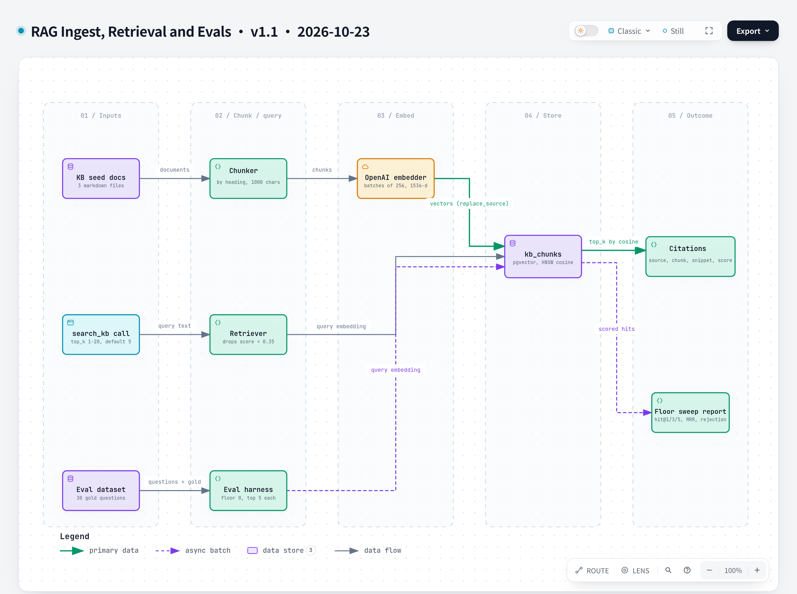

# RAG Ingest, Retrieval and Evals

**Version** 1.1 · **Date** 2026-10-23 · **Tool** archify · **Type** dataflow · **Pinned commit** `6a738dc`
**Decisions** [ADR-0010](../../decisions/0010-pgvector-in-postgres-over-chroma.md), [ADR-0011](../../decisions/0011-heading-aware-chunking-and-openai-embeddings.md), [ADR-0012](../../decisions/0012-retrieval-relevance-floor.md)
**Source** `features/claims_triage/rag/`, `evals/run_evals.py`, `evals/datasets/airline_retrieval.jsonl`



Interactive version: [`rag-evals-pipeline.html`](rag-evals-pipeline.html) · Source: [`rag-evals-pipeline.json`](rag-evals-pipeline.json)

## What it shows

Offline ingest and online retrieval meet at the `kb_chunks` table; the eval harness reads the same table and sweeps the relevance floor over saved scores. The separate agent eval (`make eval-agent`, `evals/run_agent_evals.py`) runs the whole agent on 19 labelled claims and is not drawn here.

## Like I'm 5

Imagine a library with a helpful librarian. First, someone cuts the rule books into small pieces, one for each topic, and gives each piece a special number code that describes what it is about. When you ask a question, the librarian turns your question into a code too and finds the pieces with the closest codes. If nothing is close enough, the librarian says "I do not know" instead of guessing. To check the librarian is good, we keep a list of practice questions with the right answers and test different "close enough" levels until we find the best one.

## For an interviewer

The knowledge base is three airline policy markdown files. Ingest chunks them by heading with a maximum of 1000 characters, embeds the chunks in batches with an OpenAI embedding model (1536 dimensions), and replaces each source's rows in pgvector in one transaction, so re-running ingest is safe. At query time the retriever embeds the question, orders by cosine distance with an HNSW index, and drops anything scoring under 0.35, so an off-topic question returns nothing and the agent cannot cite what it did not find. The 0.35 floor is not a guess. The eval harness retrieves once per question for 30 gold questions, then sweeps eleven floors over the saved scores without re-embedding, reporting hit at 1, 3 and 5, mean reciprocal rank and off-topic rejection (ADR-0012). Trade-off: one database for vectors and relational data keeps operations simple but is not built for huge corpora. Honest gap: the agent eval exists (19 claims, outcome and verdict accuracy) but is manual, costs money and never fails CI, so it is not a merge gate.

## Likely follow-up

Why not Chroma? pgvector keeps claims, approvals and embeddings in one transactional store (ADR-0010).

## Regenerate

Edit [`rag-evals-pipeline.json`](rag-evals-pipeline.json) (bump the version and date in `meta.title`), then from the repo root:

```bash
python docs/diagrams/render_archify.py rag-evals-pipeline
```

This runs `archify finalize dataflow` and rewrites the `.html` and `.png` next to the JSON. The HTML stays under the repo's 1000 KB `check-added-large-files` limit.

## Change log

- 1.1 (2026-10-23): the empty-agent-eval gap is replaced by the manual `make eval-agent`.
- 1.0 (2026-10-18): first versioned release; title, version and date added to the diagram itself.
