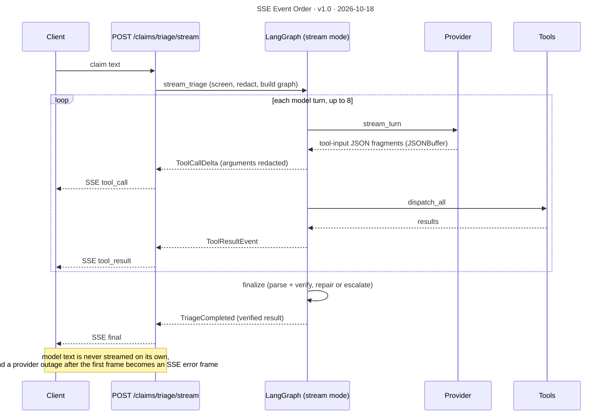

# SSE Event Order

**Version** 1.0 · **Date** 2026-10-18 · **Tool** Mermaid · **Type** sequence · **Pinned commit** `a2cbe51`
**Decisions** [ADR-0007](../decisions/0007-sse-over-websockets-for-triage-streaming.md)
**Source** see the sources listed under "What it shows"

## What it shows

An injection hit skips the graph: the stream yields only the `final` frame with the escalated result. Sources: `features/claims_triage/api/routes.py` (`triage_stream`, `_to_sse`, `_event_payload`), `application/triage_use_case.py` (`stream_triage`), `platform/ai/streaming.py`.

## Like I'm 5

Imagine a friend who tells you what they are doing as they do it. "I looked something up." "I used the calculator." "Here is the calculator's answer." You do not have to wait until the very end to find out what happened. But your friend never tells you their guess early, because the guess might be wrong. You only hear the final answer after the teacher has checked it. And if your friend suddenly cannot continue, they tell you so, instead of going quiet.

## For an interviewer

There are two triage endpoints that run the same graph and return the same verified result. The streaming one, POST /claims/triage/stream, adds progress frames before the result. It uses Server-Sent Events, not WebSockets (ADR-0007), because the traffic is one-way from server to client, SSE works over plain HTTP, and proxies and reconnects are simpler. The graph runs in stream mode. Each completed tool call is emitted as a tool_call frame with its arguments redacted, each tool result as a tool_result frame, and finally one final frame carries the verified result. While the provider streams, partial tool-argument JSON is assembled by a JSONBuffer until it parses. The key design rule is that model text is never streamed on its own, because until the finalize node has verified it, a reply may contradict the rules engine. An injection hit skips the graph and yields only the final frame. Trade-off: users do not see the reply typing out. Honest gap: once streaming has started the HTTP status cannot change, so an outage becomes an error frame, and there is no resume or last-event-id support.

## Likely follow-up

When would you choose WebSockets? If the client had to send messages mid-run, such as a live conversation with the passenger.

## Regenerate

Mermaid: edit the diagram in this file, bump the version and date in its front-matter `title:` and in the header, and add a change-log line.

## Change log

- 1.0 (2026-10-18): moved here from `decisions/0007-sse-over-websockets-for-triage-streaming.md` (section "Event order of one streamed triage"); title, version and date added to the diagram.
