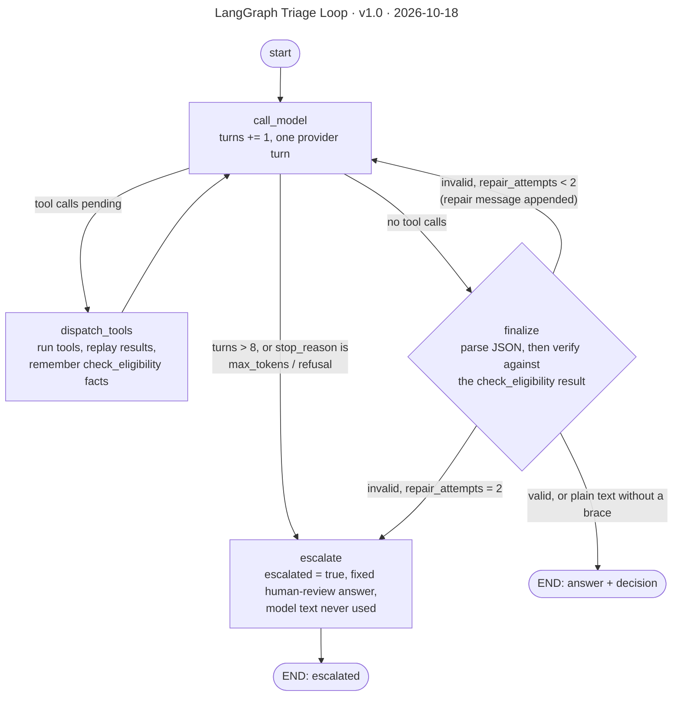

# LangGraph Triage Loop

**Version** 1.0 · **Date** 2026-10-18 · **Tool** Mermaid · **Type** flow · **Pinned commit** `cbc2790`
**Decisions** [ADR-0001](../../decisions/0001-langgraph-over-crewai.md), [ADR-0005](../../decisions/0005-prompted-json-with-repair-over-native-structured-output.md)
**Source** see the sources listed under "What it shows"

## What it shows

Three counters bound the loop: `turns` (cap `MAX_TOOL_TURNS = 8`), `repair_attempts` (cap `MAX_REPAIR_ATTEMPTS = 2`) and the unrecoverable stop reasons. Every path ends at `END`; running out of budget is a business outcome (`escalated`), never an exception. The routing mirrors `build_triage_graph().get_graph().draw_mermaid()` node for node. Sources: `features/claims_triage/agent/graph.py`, `agent/nodes/escalate_retry.py`, `application/decision.py` (`verify_decision`).

Memory beside the loop: `dispatch_tools` writes rules-derived facts into short-term memory (never into a prompt). `run_triage` loads long-term memory by `claimant_id` into the first user message and writes `last_*` facts back after a verified run. The HTTP routes do not pass `claimant_id` yet, so cross-run memory is only used by the library path.

## Like I'm 5

Imagine a helper doing homework. The helper thinks, then maybe uses a calculator, then thinks again. When the helper says "I am done", a teacher checks the answer. If it is wrong, the teacher says "try again", but only two times. If the helper keeps getting lost, or has been going round and round for too long, the helper does not shout or fall over. The helper calmly says "this is too tricky, I will ask a grown-up", and a person takes over. Nobody gets a made-up answer.

## For an interviewer

The agent is a LangGraph state graph with four nodes. call_model runs one model turn and counts it. If the model asked for tools, dispatch_tools runs them and goes back to call_model. If it did not, finalize parses the final JSON reply and verifies it against the latest check_eligibility result. A mismatch appends a repair message and loops, up to two repair attempts. Escalate is reached in three ways: more than eight turns, an unrecoverable stop reason such as a refusal or truncation, or exhausted repairs. Escalation sets a fixed human-review answer and never reuses the model's text, so a rejected verdict cannot leak out. Running out of budget is a business outcome, not an exception, so callers get an escalated result instead of a 500. We chose prompted JSON with client-side repair over native structured output (ADR-0005), and LangGraph over CrewAI because the flow is explicit and auditable (ADR-0001). Trade-off: a repair loop costs extra model calls. Honest gap: graph checkpointing and tracing are not built, so a run cannot be replayed from state.

## Likely follow-up

Why cap turns at eight? It bounds cost and latency, and a claim needing more is better handled by a human.

## Regenerate

Mermaid: edit the diagram in this file, bump the version and date in its front-matter `title:` and in the header, and add a change-log line.

## Change log

- 1.0 (2026-10-18): moved here from `decisions/0005-prompted-json-with-repair-over-native-structured-output.md` (section "The triage graph, end to end"); title, version and date added to the diagram.
